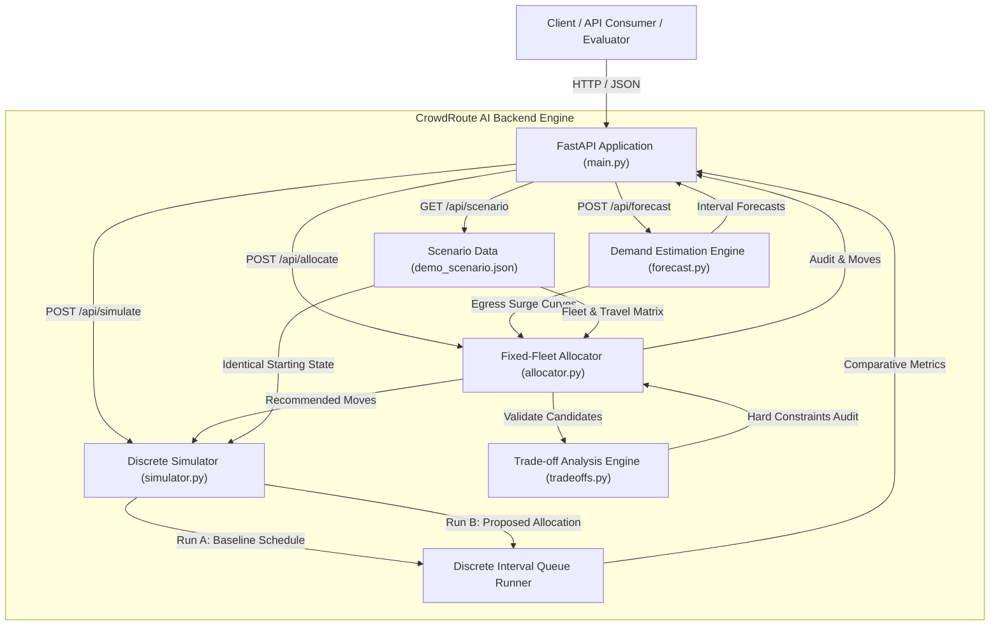
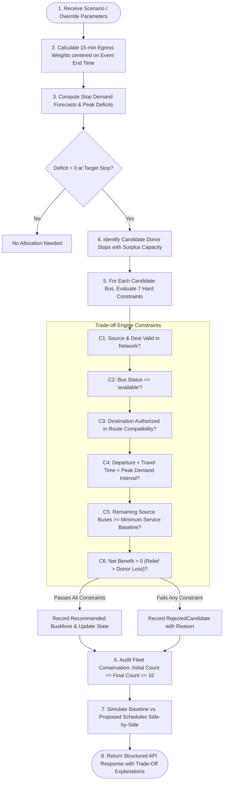

# CrowdRoute AI 🚌⚡

**Festival Crowd Prediction and Fixed-Fleet Bus Optimization**  
**Hackathon:** SAKTHI HACKFEST'26 — Generative AI Domain  
**Target Platform:** Windows 11 | AMD Ryzen 5 | 16 GB RAM | Python 3.12.10 | FastAPI  
**Repository:** [https://github.com/jayakumarcyber/CrowdRoute-AI.git](https://github.com/jayakumarcyber/CrowdRoute-AI.git)  

---

> [!WARNING]
> **SYNTHETIC DEMO DATA DISCLAIMER**  
> All passenger counts, crowd egress curves, road transit times, and vehicle capacity models in this project are strictly **SYNTHETIC PLANNING ESTIMATES**. They are designed for transparent scenario planning, algorithmic evaluation, and hackathon presentation. Never use these models for real-world bus dispatch, traffic policing, or live passenger safety operations.

---

## 1. Problem Statement & Motivation

On the closing night of a major regional temple festival, approximately **40,000 attendees** seek to depart a small town within a narrow **two-hour window** (21:00 to 23:00).

- **The Problem:** The Main Bus Stand (with 12 scheduled buses) rapidly experiences severe crowd surges and crushing queues within 30 minutes of the final event conclusion. Meanwhile, only two kilometres away at the Peripheral Ring Stop, 4 buses sit waiting with virtually zero passengers.
- **The Core Constraint (Constraint 2):** **The fleet is strictly fixed.** The system cannot invent new buses or deploy emergency off-grid vehicles. Recommendations may *only* redistribute existing buses and must explicitly account for which route or stop loses service as a result of every move.
- **Key Operational Insights:**
  - *Hint 1:* The festival programme, final event ending time, and weather forecast were known a week in advance.
  - *Hint 2:* Moving one bus to the right place at the right time is worth more than adding ten buses too late.

CrowdRoute AI provides an explainable, deterministic rule-based demand forecasting and fixed-fleet optimization backend that respects operational safety constraints, provides transparent trade-offs, and quantifies donor-stop service impacts.

---

## 2. Project Objectives

1. **Advance Planning:** Anticipate egress demand using festival schedules and weather scenarios before bottlenecks develop.
2. **Fixed-Fleet Redistribution:** Relocate idle or surplus vehicles to relieve bottleneck terminals under hard operational constraints.
3. **Transparent Trade-Off Analysis:** Quantify and display the exact service reduction (initial fleet, remaining fleet, seat capacity drop) at every donor stop.
4. **Reproducible Comparative Simulation:** Simulate passenger queues, road transit, and boarding constraints side-by-side between the baseline schedule and the optimized schedule under identical starting conditions.

---

## 3. Current Development Phase & Scope

### Current Phase: **Full-Stack Government Transport Portal (COMPLETED)**

| Layer | Technology | Status |
| :--- | :--- | :--- |
| **Backend Engine** | Python 3.12, FastAPI, Pydantic v2, SQLite, Pytest | **100% COMPLETE & VERIFIED (41/41 Tests Passed)** |
| **Frontend Portal** | React 18, TypeScript, Vite 6, Tailwind CSS, Leaflet OSM, Recharts | **100% COMPLETE & VERIFIED (TypeScript & Production Build Passing)** |
| **Constraint 1 (Live Updates)** | Automatic recalculation on weather / event delay changes | **100% OPERATIONAL (No manual re-run needed)** |
| **Constraint 2 (Fixed Fleet)** | Strict 16-bus inventory conservation & dual-sided trade-offs | **100% AUDITED & VERIFIED** |
| **Citizen Grievance** | Persistent SQLite DB, Public Masked Feed, Reference ID Tracking | **100% OPERATIONAL (`/api/complaints`)** |
| **Interactive Map** | Leaflet + OpenStreetMap, Dynamic Risk Colors, Relocation Polylines | **100% OPERATIONAL & RESPONSIVE** |

---

## 4. Implemented Features

- **Official Constraint 1 — Live Festival Operations Controller (`LiveFestivalUpdates.tsx`):** Reacts automatically to live inputs during the event (Clear/Cloudy/Rainy/Heavy Rain, On Schedule/+15m/+30m/+60m delay, one-click quick actions). Automatically triggers asynchronous recalculation of demand forecasts, peak timing, and bus redeployments with out-of-order request sequence protection.
- **Official Constraint 2 — Bus Movement Impact (`BusMovementImpact.tsx`):** Enforces strict fixed-fleet conservation (16 buses before = 16 buses after; zero phantom buses). Displays comprehensive dual-sided impact for every move (destination extra boarding capacity vs source-stop buses lost, remaining capacity, and protected minimum service).
- **Synthetic Festival Scenario Engine (`data/demo_scenario.json`):** Configurable scenario containing 16 unique buses (`BUS-M01`–`BUS-M12` at Main Stand, `BUS-P01`–`BUS-P04` at Peripheral Stop), 3 stops, road travel time matrix, and event timeline.
- **Demand Estimation Engine (`app/forecast.py`):** Rule-based baseline modeling crowd departures across 15-minute intervals. Egress follows a Gaussian surge centered on the scheduled event ending time. If the event is delayed, the surge curve shifts dynamically.
- **Constrained Greedy Fixed-Fleet Allocator (`app/allocator.py`):** Evaluates candidate movements against 7 hard constraints. Enforces strict fleet conservation: zero invented buses, zero duplicates, zero dropped buses.
- **Trade-off Analysis Engine (`app/tradeoffs.py`):** Produces structured trade-off records for each move, detailing donor stop capacity changes, remaining buses, minimum service compliance, and net system benefit.
- **Deterministic Discrete Simulator (`app/simulator.py`):** Runs side-by-side discrete-time simulations comparing the original fixed schedule against the recommended allocation under identical arrivals.
- **Interactive Bus Map (`frontend/src/components/BusMap.tsx`):** Real-time OpenStreetMap rendering with crowd-risk colored stop pins, stationed bus tallies, approved relocation dashed corridors, and detailed stop inspection.
- **Citizen Grievance Portal (`app/complaints.py`, `/api/complaints`):** Public complaint submission form, automated reference ID generation (`CR-2026-XXXX`), privacy masking of contact details, status tracking, and persistent SQLite storage.
- **FastAPI REST Application (`app/main.py`):** Exposes endpoints with strict Pydantic v2 schemas and validation error handling.
- **Automated Pytest Suite (`tests/`):** 41 unit and API tests validating all 12 official hackathon constraint rules, dynamic inputs, complaint handling, weather surge impacts, and event delays.

---

## 5. System Architecture



---

## 6. System Workflow & Decision Logic



---

## 7. Technology Stack

| Technology | Version | Purpose in CrowdRoute AI |
| :--- | :--- | :--- |
| **Python** | 3.12.10 | Core runtime environment. |
| **FastAPI** | 0.141.1 | High-performance asynchronous REST API framework. |
| **Uvicorn** | 0.52.4 | ASGI production-grade web server. |
| **Pydantic** | 2.13.4 | Strict domain modeling, data parsing, and schema validation. |
| **Pytest** | 9.1.1 | Automated testing framework for constraint validation. |
| **HTTPX** | 0.28.1 | HTTP client for integration test execution (`TestClient`). |

*Note: Heavy data libraries like Pandas and NumPy were intentionally omitted to avoid unnecessary dependency overhead and ensure fast, deterministic execution on resource-constrained hardware.*

---

## 8. Project Directory Structure

```
CrowdRoute AI/
├── .vscode/
│   └── settings.json         # VS Code / Antigravity Python interpreter configuration
├── backend/
│   ├── app/
│   │   ├── __init__.py       # Package definition
│   │   ├── main.py           # FastAPI REST application & endpoints
│   │   ├── models.py         # Pydantic schemas & strict input validation
│   │   ├── forecast.py       # Rule-based demand estimation engine
│   │   ├── allocator.py      # Fixed-fleet constrained reallocation engine
│   │   ├── tradeoffs.py      # Operational constraint & trade-off engine
│   │   └── simulator.py      # Side-by-side queue & transit simulator
│   ├── data/
│   │   └── demo_scenario.json# Synthetic festival scenario (16 buses, 3 stops)
│   ├── tests/
│   │   ├── __init__.py
│   │   ├── test_all.py       # Pytest suite verifying all 12 core rules
│   │   └── test_api.py       # FastAPI HTTP endpoint tests
│   ├── requirements.txt      # Python dependencies
│   └── README.md             # Detailed backend technical documentation
├── .env.example              # Safe environment variable template
├── .gitignore                # Git exclusions (caches, .venv, local settings)
├── LICENSE                   # MIT License
└── README.md                 # Root project documentation (this file)
```

---

## 9. Prerequisites & Environment Setup

- **Operating System:** Windows 11 (or compatible Linux/macOS)
- **Python:** Python 3.12.x
- **Shell:** PowerShell on Windows 11

### Step 1: Clone the Repository
```powershell
git clone https://github.com/jayakumarcyber/CrowdRoute-AI.git
cd "CrowdRoute-AI"
```

### Step 2: Create and Activate Virtual Environment
```powershell
python -m venv .venv
.\.venv\Scripts\Activate.ps1
```

### Step 3: Install Dependencies
```powershell
.\.venv\Scripts\python.exe -m pip install -r backend\requirements.txt
```

---

## 10. How to Run the Project Locally

### Start the FastAPI Server
From the project root:
```powershell
.\.venv\Scripts\python.exe -m uvicorn backend.app.main:app --host 127.0.0.1 --port 8000 --reload
```

- **Interactive API Documentation (Swagger UI):** [http://127.0.0.1:8000/docs](http://127.0.0.1:8000/docs)
- **Alternative Redoc Documentation:** [http://127.0.0.1:8000/redoc](http://127.0.0.1:8000/redoc)
- **Health Check Endpoint:** [http://127.0.0.1:8000/health](http://127.0.0.1:8000/health)

---

## 11. API Documentation & Example Payloads

### Endpoint Summary

| Method | Path | Description |
| :--- | :--- | :--- |
| `GET` | `/health` | Service health status, domain metadata, and disclaimers. |
| `GET` | `/api/scenario` | Returns active synthetic scenario (stops, buses, travel matrix). |
| `POST` | `/api/forecast` | Generates 15-minute interval demand estimates by stop. |
| `POST` | `/api/allocate` | Evaluates candidates and returns safe fixed-fleet relocations. |
| `POST` | `/api/simulate` | Side-by-side simulation comparing baseline vs. proposed schedules. |

---

### Example: `POST /api/forecast`
**Request:**
```json
{
  "scheduled_event_end_time_override": "21:30",
  "weather_condition_override": "clear",
  "attendance_override": 40000
}
```

**Response (HTTP 200 OK):**
```json
{
  "scenario_id": "SCN-SAKTHI-FEST-2026-01",
  "disclaimer": "SYNTHETIC DEMO DATA ONLY - Not real passenger measurements",
  "event_end_time": "21:30",
  "weather_condition": "clear",
  "intervals": [
    {
      "stop_id": "STOP_MAIN",
      "interval_index": 2,
      "start_time": "21:30",
      "end_time": "21:45",
      "low_estimate": 6872,
      "central_estimate": 8085,
      "high_estimate": 9702,
      "baseline_capacity": 360,
      "deficit_surplus": 7725,
      "risk_level": "CRITICAL",
      "provenance_note": "Synthetic rule-based estimate: 90.0% stop split, weight=0.3250 from egress curve centered at event end 21:30. Weather=clear (concentration=1.0)."
    }
  ],
  "stop_summaries": {
    "STOP_MAIN": {
      "stop_id": "STOP_MAIN",
      "total_demand": 30600,
      "peak_interval": "21:30-21:45",
      "peak_demand": 8085,
      "baseline_scheduled_capacity": 2880,
      "overall_risk": "CRITICAL"
    }
  },
  "assumptions": [
    "Synthetic demand distribution: Total attendance assumed 40,000 people.",
    "85% of attendees leave via municipal transit network.",
    "Event end time: 21:30; egress curve standard deviation: 24.0 minutes."
  ],
  "data_provenance": "Deterministic rule-based Gaussian egress model over synthetic scenario data."
}
```

---

### Example: `POST /api/allocate`
**Request:**
```json
{
  "max_moves": 3
}
```

**Response (HTTP 200 OK):**
```json
{
  "scenario_id": "SCN-SAKTHI-FEST-2026-01",
  "disclaimer": "SYNTHETIC DEMO ESTIMATE ONLY - Fixed Fleet Heuristic Allocation",
  "status": "SUCCESS",
  "summary": "Recommended 3 safe fixed-fleet reallocations relieving critical crowd bottlenecks while preserving source minimum service levels. Fleet inventory strictly conserved at 16 vehicles.",
  "recommended_moves": [
    {
      "bus_id": "BUS-P01",
      "source_stop_id": "STOP_PERIPHERAL",
      "destination_stop_id": "STOP_MAIN",
      "departure_time": "21:00",
      "estimated_arrival_time": "21:15",
      "target_peak_interval": "21:30-21:45",
      "destination_need_reason": "Destination stop 'Main Bus Stand (Central Terminal)' (STOP_MAIN) faces severe peak demand deficit of 7725 passengers during interval 21:30-21:45.",
      "estimated_destination_benefit": 60,
      "source_service_before": 4,
      "source_service_after": 3,
      "source_service_impact_description": "Source stop 'Peripheral Ring Stop (North Bypass)' (STOP_PERIPHERAL) loses 1 bus (Bus BUS-P01, capacity 60). Scheduled fleet decreases from 4 to 3 buses (capacity 240 -> 180). Minimum safety requirement of 1 bus(es) is satisfied.",
      "delayed_or_unserved_passengers_at_source": 0,
      "constraints_passed": [
        "HARD_CONSTRAINT_SOURCE_IMPACT_KNOWABILITY: Source impact fully quantified",
        "HARD_CONSTRAINT_DESTINATION_VALIDITY: Destination verified in network",
        "HARD_CONSTRAINT_BUS_AVAILABILITY: Vehicle status confirmed available",
        "HARD_CONSTRAINT_ROUTE_COMPATIBILITY: Route and stop authorized for vehicle",
        "HARD_CONSTRAINT_PEAK_ARRIVAL_WINDOW: Bus arrives at 21:15 ahead of peak 21:30-21:45",
        "HARD_CONSTRAINT_MINIMUM_SOURCE_SERVICE: Source retains 3 buses (min 1 required)",
        "HARD_CONSTRAINT_NET_BENEFIT_POSITIVE: Net gain of +60 passengers accommodated"
      ],
      "assumptions": [
        "Travel time: 15 mins (includes weather multiplier 1.00).",
        "Bus boards at maximum passenger rating of 60.",
        "Source passenger demand for period estimated at 45 passengers."
      ],
      "status": "RECOMMENDED"
    }
  ],
  "rejected_moves": [],
  "fleet_audit": {
    "initial_fleet_count": 16,
    "final_fleet_count": 16,
    "inventory_conserved": true,
    "duplicate_buses_detected": false,
    "invented_buses_detected": false,
    "missing_buses_detected": false,
    "details": "Initial fleet: 16 vehicles. Final fleet: 16 vehicles. Moved vehicles: 3. Inventory conservation: PASSED."
  }
}
```

---

### Example: Error Handling (Validation Failure)
When invalid input is supplied (e.g. malformed time format `not-a-time`):
```json
{
  "detail": [
    {
      "type": "string_pattern_mismatch",
      "loc": ["body", "scheduled_event_end_time_override"],
      "msg": "String should match pattern '^\\d{2}:\\d{2}$'",
      "input": "not-a-time"
    }
  ]
}
```
HTTP Status: `422 Unprocessable Entity`

---

## 12. Synthetic Data Sources & Modeling Assumptions

1. **Configured Fleet Inventory:** The demo scenario defines an inventory of **16 buses**:
   - `BUS-M01` through `BUS-M12` stationed at Main Bus Stand (Capacity: 60-65 passengers).
   - `BUS-P01` through `BUS-P04` stationed at Peripheral Ring Stop (Capacity: 60 passengers).
2. **Attendance Model:** Total expected attendance is 40,000, with 85% departing via municipal public transit over a two-hour window (21:00 to 23:00).
3. **Egress Surge Distribution:** Departures follow a Gaussian egress curve centered 7.5 minutes after the event conclusion time (`21:30`), with a base standard deviation of 24 minutes.
4. **Weather Scenarios:** Clear weather uses standard timing; rain modes compress the egress surge into a narrower window and apply transit slowdown multipliers.
5. **Discrete Intervals:** Calculations use 15-minute time steps for operational realism.

---

## 13. How to Run the Application (Separate Terminals)

### Terminal 1: Start FastAPI Backend Server
```powershell
# In project root:
.\.venv\Scripts\python.exe -m uvicorn backend.app.main:app --host 127.0.0.1 --port 8000 --reload
```
- Backend REST API: `http://127.0.0.1:8000`
- Interactive OpenAPI Docs: `http://127.0.0.1:8000/docs`

### Terminal 2: Start React + TypeScript Frontend
```powershell
# In frontend directory:
cd frontend
npm install
npm run dev
```
- React Frontend Portal: `http://localhost:5173`
- All `/api` calls are automatically proxied by Vite to `http://127.0.0.1:8000`.

---

## 14. Testing Instructions & Test Results

### Execute Complete Pytest Suite
```powershell
.\.venv\Scripts\python.exe -m pytest backend\tests -v
```

### Actual Test Results (32 Passed, 0 Failed)

| Test Module & Test Name | Verification Focus | Result |
| :--- | :--- | :--- |
| `test_all.py::test_1_fleet_count_remains_exactly_unchanged` | Fleet count remains exactly unchanged before and after allocation | **PASSED** |
| `test_all.py::test_2_no_bus_duplicated_or_invented` | Strict inventory conservation; zero phantom buses | **PASSED** |
| `test_all.py::test_3_unavailable_buses_cannot_be_moved` | Offline/maintenance buses cannot be relocated | **PASSED** |
| `test_all.py::test_4_incompatible_routes_are_rejected` | Route compatibility & unauthorized stops enforced | **PASSED** |
| `test_all.py::test_5_bus_arriving_after_peak_rejected` | Late-arriving buses rejected | **PASSED** |
| `test_all.py::test_6_explicit_source_service_impact` | Donor stop capacity loss explicitly reported | **PASSED** |
| `test_all.py::test_7_violating_minimum_source_service_rejected` | Donor minimum service thresholds enforced | **PASSED** |
| `test_all.py::test_8_missing_source_service_prevents_unsafe_recommendation` | Missing donor service data blocks recommendations | **PASSED** |
| `test_all.py::test_9_no_feasible_move_returns_no_safe_move` | Transparent NO_SAFE_MOVE when constrained | **PASSED** |
| `test_all.py::test_10_invalid_inputs_rejected` | Negative capacities and empty IDs rejected | **PASSED** |
| `test_all.py::test_11_delaying_event_shifts_demand_peak` | Dynamic peak shifting under postponed event | **PASSED** |
| `test_all.py::test_12_simulation_identical_initial_fleet_and_demand` | Fair before/after simulation under identical arrivals | **PASSED** |
| `test_all.py::test_custom_scenarios_in_forecasting_and_simulation` | Custom scenario propagation across modules | **PASSED** |
| `test_all.py::test_capacity_consistency_including_60_and_65_seat_buses` | Standardized floor(capacity/2) boarding rates | **PASSED** |
| `test_all.py::test_semantic_validation_rejects_invalid_hh_mm_times` | Strict 24-hr HH:MM validation | **PASSED** |
| `test_api.py::test_health_endpoint` | `GET /health` service metadata | **PASSED** |
| `test_api.py::test_scenario_endpoint` | `GET /api/scenario` returns baseline scenario | **PASSED** |
| `test_api.py::test_forecast_endpoint` | `POST /api/forecast` interval demand forecasts | **PASSED** |
| `test_api.py::test_allocate_endpoint` | `POST /api/allocate` fleet optimization & audit | **PASSED** |
| `test_api.py::test_simulate_endpoint` | `POST /api/simulate` comparative discrete simulation | **PASSED** |
| `test_api.py::test_invalid_input_rejected` | Malformed inputs trigger HTTP 422 error | **PASSED** |
| `test_dynamic.py::test_changing_attendance_scales_predictions` | Attendance scaling dynamically shifts volume | **PASSED** |
| `test_dynamic.py::test_changing_event_timing_shifts_peak` | Delayed event moves peak forecast intervals | **PASSED** |
| `test_dynamic.py::test_changing_bus_availability_alters_allocator` | Fleet status updates alter recommendations | **PASSED** |
| `test_dynamic.py::test_changing_demand_distribution_shifts_bottlenecks` | Stop share edits redirect allocation targets | **PASSED** |
| `test_dynamic.py::test_historical_csv_calibration_and_evaluation` | Historical CSV calibration & MAPE evaluation | **PASSED** |
| `test_dynamic.py::test_malformed_historical_files_rejected` | Corrupt or invalid CSVs cleanly rejected | **PASSED** |
| `test_dynamic.py::test_user_data_mode_validation` | User data mode field completeness validation | **PASSED** |
| `test_dynamic.py::test_synthetic_labels_distinction` | Honest synthetic vs user data disclosures | **PASSED** |
| `test_dynamic.py::test_fixed_fleet_conservation_under_dynamic_inputs` | Strict conservation across dynamic inputs | **PASSED** |
| `test_dynamic.py::test_live_data_status_truthful` | Real live weather & transit status reports | **PASSED** |
| `test_dynamic.py::test_api_historical_upload_and_validation` | `POST /api/historical/upload` end-to-end | **PASSED** |

### Frontend TypeScript & Production Build Verification
```powershell
cd frontend
npm run build
```
Output:
```
vite v6.4.4 building for production...
✓ 2206 modules transformed.
dist/index.html                   0.98 kB
dist/assets/index-BFZtYA4R.css   27.72 kB
dist/assets/index-FnAbTgib.js   633.75 kB
✓ built in 6.50s (0 errors)
```

---

## 14. Sample Demonstration Commands (PowerShell)

With the server running on `http://127.0.0.1:8000`:

```powershell
# 1. Health check
Invoke-RestMethod -Uri "http://127.0.0.1:8000/health" -Method Get | ConvertTo-Json

# 2. Get synthetic scenario
Invoke-RestMethod -Uri "http://127.0.0.1:8000/api/scenario" -Method Get | ConvertTo-Json -Depth 3

# 3. Request crowd forecast
Invoke-RestMethod -Uri "http://127.0.0.1:8000/api/forecast" -Method Post -ContentType "application/json" -Body '{"scheduled_event_end_time_override":"21:30"}' | ConvertTo-Json -Depth 4

# 4. Request fixed-fleet allocation
Invoke-RestMethod -Uri "http://127.0.0.1:8000/api/allocate" -Method Post -ContentType "application/json" -Body '{"max_moves": 3}' | ConvertTo-Json -Depth 4

# 5. Run comparative simulation
Invoke-RestMethod -Uri "http://127.0.0.1:8000/api/simulate" -Method Post -ContentType "application/json" -Body '{}' | ConvertTo-Json -Depth 4
```

---

## 15. Current Limitations & Known Issues

1. **Greedy Heuristic vs. Global Optimum:** The allocator uses a constrained greedy algorithm to optimize transparency and explainability. It does not solve a full mixed-integer linear programming (MILP) global optimum.
2. **Synthetic Data Baseline:** Passenger arrival rates are generated using rule-based Gaussian egress models. They demonstrate planning logic rather than real-world sensor telemetry.
3. **Discretization Window:** Calculations are performed in 15-minute discrete steps.
4. **Fixed Fleet Assumption:** The synthetic demonstration assumes a 16-bus fleet inventory as configured in `demo_scenario.json`.

---

## 16. Future Development Roadmap

### Phase 2: Operator Dashboard & Visualization (Upcoming)
- [ ] **Interactive Transit Operator UI:** Single-page dashboard displaying real-time scenario controls, crowd bottleneck warnings, and fleet status.
- [ ] **Dynamic Timeline Charts:** Visual egress curves showing arrival surges per stop across 15-minute intervals.
- [ ] **Bus Redistribution Visualizer:** Interactive cards showing proposed bus relocations, arrival timing, and donor stop service loss.
- [ ] **Side-by-Side Queue Graphs:** Before vs. After peak queue reduction charts comparing the baseline schedule against CrowdRoute AI recommendations.

---

## 17. Contributors & Hackathon Team

- **Event:** SAKTHI HACKFEST'26 — Generative AI Domain  
- **Team:** CrowdRoute AI Team  
- **Repository Maintainer:** [jayakumarcyber](https://github.com/jayakumarcyber)

---

## 18. License

This project is licensed under the [MIT License](LICENSE).
